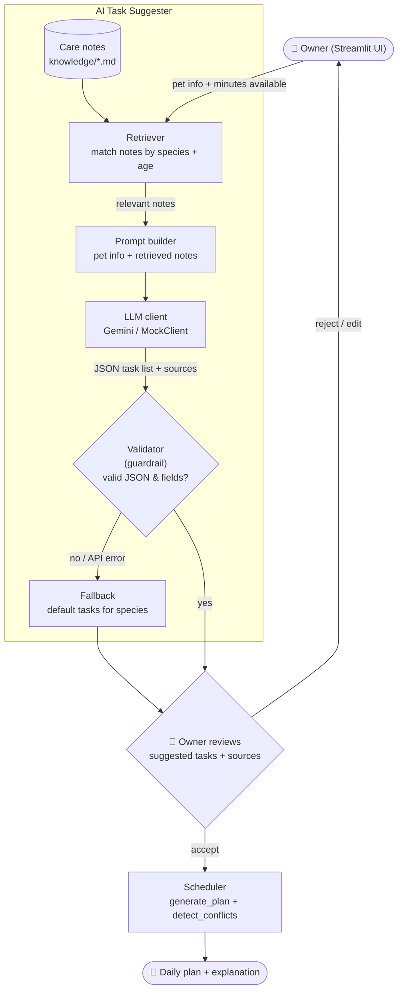

# 🐾 PawPal+ AI: Pet Care Planner with Retrieval-Augmented Task Suggestions

PawPal+ AI helps busy pet owners build a daily care routine. You tell it about your pet, and it
**looks up care guidelines for that pet's species and age, asks an LLM to suggest care tasks based
on those guidelines, checks every suggestion, and lets you approve them** before they go into a
time-budgeted daily schedule.

New pet owners often don't know what care a puppy or a senior cat needs, and generic chatbot advice
can be vague or made up. PawPal+ AI keeps the AI grounded: every suggested task has to cite the
care note it came from, and anything that doesn't pass validation is thrown out before the owner
sees it.

## Original Project

This project extends **PawPal+ (Module 2 Project)**. The original PawPal+ was a Streamlit app where
owners entered their pets and care tasks by hand (walks, feeding, meds, grooming), each with a
duration, priority, and frequency. A rule-based `Scheduler` then built a daily plan that fit the
owner's available time, pinned fixed-time tasks, flagged overlapping tasks, and explained why each
task was scheduled or skipped. It had no AI. This version adds an AI task suggester on top of that
scheduler.

## Architecture Overview

The full diagram source is in [`diagrams/system_diagram.mmd`](diagrams/system_diagram.mmd).



1. **Input:** The owner adds a pet (name, species, age) and sets how many minutes they have today.
2. **Retriever** (`retrieve_notes`): Picks the matching note from `knowledge/` based on species and
   life stage (for example `dog_puppy.md` for a dog under 1 year, `cat_senior.md` for a cat 11 or
   older), plus `general.md`, which is always included.
3. **Prompt builder + LLM** (`build_prompt`, `llm_client.py`): Sends Gemini the pet's details, the
   time budget, the pet's existing tasks, and the retrieved notes. The model must return a JSON list
   of tasks, and each task must name the note that supports it.
4. **Validator (guardrail)** (`parse_and_validate`): Checks every task's duration, priority,
   category, frequency, and time. It rejects tasks whose source isn't one of the retrieved notes,
   duplicates of tasks the pet already has, and anything past an 8-task limit.
5. **Fallback** (`fallback_tasks`): If the API fails, there is no API key, or nothing passes
   validation, the app suggests safe default tasks for the species instead of crashing.
6. **Human review:** The owner sees each suggestion with its source and reason. They can untick it
   or change its minutes and priority, then add the accepted tasks.
7. **Output:** Accepted suggestions become normal `Task` objects. The original `Scheduler` fits them
   into the day and explains the plan.

**Logging and testing:** Every step (notes retrieved, raw LLM reply, rejections, fallbacks, API
errors) is written to `pawpal_ai.log` and shown in the app's **AI activity log** panel. The pytest
suite tests the retriever, validator, fallback, and scheduler with a fake LLM.

## Setup Instructions

Requires **Python 3.10+**.

```bash
# 1. Clone the repo and enter it
git clone <your-repo-url>
cd applied-ai-system-project

# 2. Create and activate a virtual environment
python -m venv .venv
source .venv/bin/activate        # Windows: .venv\Scripts\activate

# 3. Install dependencies
pip install -r requirements.txt

# 4. Add your Gemini API key (optional, see note below)
cp .env.example .env             # Windows: copy .env.example .env
# then open .env and set GEMINI_API_KEY=your_key

# 5. Run the app
streamlit run app.py

# 6. Run the tests (no API key needed)
pytest
```

You can get a free Gemini API key at <https://aistudio.google.com/apikey>. **Without a key, the app
still runs in offline mode**: the AI call is skipped and default tasks for the pet's species are
suggested, so you can try the whole flow.

**Other ways to run it:**

- `python demo_ai.py` runs the suggester for three sample pets and prints the suggestions and the
  final schedule. Add `--offline` to force offline mode, or `--guardrail` to feed a bad AI reply
  through the validator.
- `python main.py` runs the original rule-based scheduling demo.

**Using the app:**

1. Add a pet under **Add a Pet**.
2. Under **✨ AI Task Suggestions**, pick the pet and click **Suggest tasks**.
3. Review the table. Untick anything you don't want and adjust minutes or priority if needed. Click
   **Add accepted tasks**.
4. Click **Generate schedule** to see the daily plan.

## Sample Interactions

All samples below are real output from `python demo_ai.py`, which uses the same `suggest_tasks()` function as
the app. The owner has 120 minutes and their day starts at 07:30.

### 1. Puppy, using Gemini (`gemini-3.5-flash`)

Command: `python demo_ai.py` (with `GEMINI_API_KEY` set in `.env`)

```
INPUT: Mochi, 0-year-old dog | existing tasks: none
Retrieved notes: dog_puppy.md, general.md
Used fallback: False
  - Morning puppy meal (10 min, high, feeding, daily @ 07:30) [source: dog_puppy.md]
      why: Puppies require 3 small meals a day at regular times.
  - Midday puppy meal (10 min, high, feeding, daily @ 12:00) [source: dog_puppy.md]
      why: Puppies need regular small meals scheduled throughout the day.
  - Evening puppy meal (10 min, high, feeding, daily @ 18:00) [source: dog_puppy.md]
      why: Feeding 3 small meals daily helps support puppy growth and routine.
  - Refill fresh water bowl (2 min, high, feeding, daily) [source: general.md]
      why: Water bowls should be cleaned and refilled daily for all pets.
  - Puppy training session (10 min, medium, enrichment, daily) [source: dog_puppy.md]
      why: Short training sessions of 5 to 10 minutes daily work best for puppies.
  - Calm socialization exposure (5 min, medium, enrichment, daily) [source: dog_puppy.md]
      why: Puppies need a few minutes a day of calm exposure to new sounds, people, and surfaces.
  - Gentle grooming and handling (5 min, low, grooming, weekly) [source: dog_puppy.md]
      why: Gentle brushing and handling of paws and ears a few times a week gets the puppy used to grooming.
  - Daily health check (5 min, medium, general, daily) [source: general.md]
      why: A daily check helps monitor the pet for any changes in appetite, energy, or behavior.
```

The AI followed the puppy note closely: three meals pinned at spread-out times, short training
sessions, socialization, and gentle handling, each citing its note. It did not include potty
breaks or a walk, even though `dog_puppy.md` mentions both, because it used all 8 of its allowed
tasks. That is one reason the owner reviews suggestions before scheduling them.

### 2. Senior cat with an existing task, using Gemini

Luna already has a 07:30 Breakfast, so the AI should not suggest breakfast again.

```
INPUT: Luna, 12-year-old cat | existing tasks: Breakfast
Retrieved notes: cat_senior.md, general.md
Used fallback: False
  - Dinner feeding (5 min, medium, feeding, daily) [source: cat_senior.md]
      why: Senior cats benefit from 2 to 3 smaller meals a day taking about 5 minutes each.
  - Scoop litter box (5 min, medium, cleaning, daily) [source: cat_senior.md]
      why: Litter boxes should be scooped daily and kept accessible for senior cats.
  - Gentle play session (10 min, medium, enrichment, daily) [source: cat_senior.md]
      why: Short, gentle play sessions of 5 to 10 minutes keep older cats engaged.
  - Brush coat (10 min, low, grooming, weekly) [source: cat_senior.md]
      why: Older cats groom themselves less, so they should be brushed a few times a week.
  - Refresh water (2 min, high, general, daily) [source: cat_senior.md]
      why: Senior cats are prone to dehydration and require fresh water daily.
  - Daily health check (5 min, medium, general, daily) [source: general.md]
      why: A daily check involves inspecting the pet for changes in appetite, energy, or behavior.
```

The AI skipped breakfast and suggested senior-specific care (gentle play, extra brushing,
hydration). Together with a puppy and another pet, the scheduler fit everything into 116 of the
120 minutes and skipped one 20-minute weekly task that didn't fit.

### 3. Guardrail: rejecting a bad AI reply

Command: `python demo_ai.py --guardrail`

Input: a fixed reply sent through a fake client instead of Gemini. It is wrapped in a markdown code
fence and has one good task and three bad ones: a made-up source, a 300-minute duration, and an
invalid priority and time. The full reply is `BAD_REPLY` in `demo_ai.py`.

```json
[
  {"description": "Breakfast", "duration_minutes": 10, "priority": "high", "source": "dog_puppy.md", ...},
  {"description": "Puppy kindergarten", "duration_minutes": 90, "source": "akc.org", ...},
  {"description": "Long run", "duration_minutes": 300, "source": "dog_puppy.md", ...},
  {"description": "Midnight snack", "priority": "urgent", "preferred_start": "24:30", ...}
]
```

Output:

```
$ python demo_ai.py --guardrail
Client: CannedClient (fixed reply: 1 valid task, 3 invalid)

Used fallback: False
  KEPT: Breakfast (10 min) [source: dog_puppy.md]
  REJECTED: Puppy kindergarten: source 'akc.org' is not one of the retrieved notes
  REJECTED: Long run: duration 300 outside 1-240
  REJECTED: Midnight snack: invalid priority 'urgent'
```

The task citing an outside source was rejected even though it was otherwise valid. Only tasks
grounded in the retrieved notes get through. This output is the same every time.

### 4. Offline mode (no API key)

Input: `python demo_ai.py --offline`. The retriever still runs, but there is no LLM reply, so the
fallback takes over. Here is the senior cat and the start of the final schedule:

```
INPUT: Luna, 12-year-old cat | existing tasks: Breakfast
Retrieved notes: cat_senior.md, general.md
Used fallback: True
  - Dinner (5 min, high, feeding, daily) [source: fallback (default tasks)]
  - Scoop litter box (5 min, high, cleaning, daily) [source: fallback (default tasks)]
  - Interactive play (15 min, medium, enrichment, daily) [source: fallback (default tasks)]
  - Refresh water (2 min, medium, general, daily) [source: fallback (default tasks)]
  REJECTED: LLM returned an empty response

Daily plan for Jordan (116 of 120 min used):
  07:30-07:35  Luna: Breakfast (5 min) - pinned to 07:30, high priority
  07:35-07:45  Mochi: Breakfast (10 min) - high priority
  07:45-07:55  Mochi: Dinner (10 min) - high priority
  07:55-08:25  Mochi: Walk (30 min) - high priority
  ...
```

The fallback skipped "Breakfast" for Luna because she already has that task.

## Design Decisions

- **RAG over a small, hand-written knowledge base.** I wrote seven short markdown notes instead of
  letting the model answer from its own knowledge. That makes the suggestions traceable: every task
  shows which note it came from, and the owner can open the notes in the app.
  *Trade-off:* the notes cover only dogs and cats at three life stages, plus general care, so other
  species get generic suggestions.
- **Simple filename-based retrieval instead of embeddings.** Notes are named `species_stage.md`, so
  retrieval is a dictionary-style lookup with no vector database. It is fast, free, deterministic,
  and easy to test.
  *Trade-off:* it can't match free-text questions or pick out details like breed. With a larger
  knowledge base, embedding search would be worth adding.
- **The LLM suggests, the existing code schedules.** The model only proposes tasks. The tested,
  rule-based `Scheduler` from the original project decides timing, time budget, and conflicts.
  LLMs are bad at arithmetic and time slots, and the scheduler already handled those correctly.
- **One LLM call, no agent loop.** I first considered an agent that plans, schedules, checks for
  conflicts, and revises. I chose a single call plus validation because it is simpler,
  cheaper, and easier to test, and the scheduler already handles conflicts.
  *Trade-off:* the AI never sees the final schedule, so it can't adjust its suggestions to it.
- **Strict validation and a source check.** The LLM's output is treated as untrusted. Each task is
  checked field by field, and tasks are dropped one at a time, so one bad task doesn't throw out the
  good ones. A task must also cite a note that was actually retrieved, which catches the model
  inventing sources.
- **Always fall back, never crash.** API errors, bad JSON, empty replies, and a missing API key all
  lead to default tasks. The app works offline, which also makes it easy for others to try.
- **Human in the loop.** Nothing is scheduled until the owner accepts it. Pet care decisions belong
  to the owner, and the validator can check that a task is well-formed but not whether it is right
  for that pet.

## Testing Summary

**Summary:** 17/17 automated tests pass. In the live Gemini runs, 3 of 4 requests returned
suggestions, and every one passed validation and cited a retrieved note. The fourth hit a 503
overload error and fell back to default tasks safely. The AI's main weakness was leaving out
important tasks: the puppy plan had no potty breaks or walks.

### Evaluation results

Live rows use real `gemini-3.5-flash` output from `python demo_ai.py` (see Sample Interactions).
Guardrail rows use a fake client (`python demo_ai.py --guardrail` and `pytest`). I judged each result against the criteria by
hand.

| Test input | Evaluation criteria | Result |
|---|---|---|
| Puppy (dog, age 0), live Gemini | Uses `dog_puppy.md`; covers meals, potty breaks, short walks, training; every task cites a retrieved note | **Partial:** 3 meals, training, socialization, grooming, all cited correctly; **no potty breaks or walks** (used all 8 task slots) |
| Senior cat (age 12) with existing Breakfast, live Gemini | Uses `cat_senior.md`; doesn't repeat Breakfast; includes senior-specific care | **Pass:** no breakfast duplicate; suggested gentle play, extra brushing, hydration |
| "Other" pet (age 2), live Gemini | Uses only `general.md`; tasks are generic and cited | **Pass:** water, health check, habitat cleaning, all citing `general.md` |
| Combined plan for all 3 pets | Fits the 120-minute budget; no conflicts | **Pass:** 116 of 120 min used; one 20-min weekly task skipped; no conflicts |
| Gemini returns 503 "high demand" | Doesn't crash; pet still gets tasks; error logged | **Pass:** fallback tasks used; other pets unaffected; error in `pawpal_ai.log` |
| Wrong model name (404) | Doesn't crash; error logged | **Pass:** fallback for all pets; 404 logged (fixed by changing the default model) |
| No API key (offline mode) | App runs end to end | **Pass:** default tasks suggested; schedule generated |
| Reply with a made-up source (`akc.org`), duration 300, priority "urgent" | Bad tasks rejected, good task kept | **Pass:** 1 kept, 3 rejected with reasons |
| Reply that isn't JSON | Doesn't crash; falls back | **Pass:** "not valid JSON" logged; fallback used |

**Biggest gap found:** The validator checks that tasks are well-formed and grounded in a note, but
not that the essential ones are included. A next step would be a coverage check, for example
requiring a potty or walk task for puppies, which would warn the owner when one is missing.

### Automated tests

```
$ pytest -v
collecting ... collected 17 items

tests/test_ai_suggester.py::test_life_stage_by_species_and_age PASSED    [  5%]
tests/test_ai_suggester.py::test_retrieve_notes_picks_matching_note_plus_general PASSED [ 11%]
tests/test_ai_suggester.py::test_retrieve_notes_for_other_species_uses_general_only PASSED [ 17%]
tests/test_ai_suggester.py::test_retrieve_notes_skips_missing_files PASSED [ 23%]
tests/test_ai_suggester.py::test_prompt_contains_retrieved_notes_and_pet_info PASSED [ 29%]
tests/test_ai_suggester.py::test_valid_json_becomes_tasks PASSED         [ 35%]
tests/test_ai_suggester.py::test_code_fenced_json_is_accepted PASSED     [ 41%]
tests/test_ai_suggester.py::test_bad_items_rejected_but_good_ones_kept PASSED [ 47%]
tests/test_ai_suggester.py::test_duplicates_of_existing_tasks_are_rejected PASSED [ 52%]
tests/test_ai_suggester.py::test_suggestions_capped_at_limit PASSED      [ 58%]
tests/test_ai_suggester.py::test_suggest_tasks_uses_llm_when_reply_is_valid PASSED [ 64%]
tests/test_ai_suggester.py::test_invalid_json_falls_back_to_defaults PASSED [ 70%]
tests/test_ai_suggester.py::test_empty_reply_and_client_errors_fall_back PASSED [ 76%]
tests/test_ai_suggester.py::test_accepted_suggestions_flow_into_scheduler PASSED [ 82%]
tests/test_ai_suggester.py::test_long_or_multiline_pet_name_is_trimmed_in_prompt PASSED [ 88%]
tests/test_pawpal.py::test_mark_complete_changes_task_status PASSED      [ 94%]
tests/test_pawpal.py::test_add_task_increases_pet_task_count PASSED      [100%]

============================== 17 passed in 0.03s ==============================
```

**17 tests pass**. 15 are new tests for the AI suggester in
`tests/test_ai_suggester.py`, and 2 are original scheduler tests. The AI tests use a fake LLM
client, so they are deterministic and need no API key. They cover:

- **Retriever:** the right life stage for each species and age, the right notes picked, other
  species getting only `general.md`, and missing note files skipped.
- **Prompt:** the retrieved note text, pet details, time budget, and existing tasks all appear in
  the prompt.
- **Validator:** valid JSON becomes `Task` objects, code-fenced JSON is accepted, bad fields are
  rejected while good items are kept, sources that weren't retrieved are rejected, duplicates are
  rejected, the 8-task limit holds, and long or multi-line pet names are trimmed before they reach the prompt.
- **End to end:** a valid reply produces suggestions, while bad JSON, empty replies, and client
  errors all fall back. Accepted suggestions are planned by the `Scheduler` with no conflicts.

I also ran the Streamlit app headlessly with `streamlit.testing`: add a pet, get suggestions, accept
them, and generate a schedule, with no exceptions.

**What worked:** Keeping the AI step behind one function, `suggest_tasks()`, with a pluggable client
made testing easy. The fake client let me test every failure path without calling the API.

**What didn't work at first:** After clicking **Add accepted tasks**, the app reran to refresh the
task list, and the success message disappeared with the rerun. I fixed it by saving the message in
session state and showing it on the next run.

**What happened against the real Gemini API:**

- The model name I first used (`gemini-flash-lite-latest`) returned a 404. The app didn't crash:
  the client logged the error and every pet got fallback tasks. I listed the models available to
  my key and switched the default to `gemini-3.5-flash`. It can be changed with `GEMINI_MODEL` in `.env`.
- On one run, a request returned **503 "model experiencing high demand"**. That pet got fallback
  tasks and the other two still got AI suggestions, so a failure only affects the request it
  happens on.
- Once the model was reachable, all of its replies passed validation and every task cited a
  retrieved note.
- The puppy reply used the full 8-task limit and left out potty breaks and walks. The validator
  only checks that tasks are well-formed and grounded, not that the most important ones are
  included.

**What I learned:** The most useful tests were the failure cases (bad JSON, invented sources,
out-of-range values), because those are the things an LLM actually does that a normal function
doesn't.

## Reflection

> **TODO:** Write a few sentences in your own words. Some prompts: What surprised you about
> connecting an LLM to real application logic? How did breaking the problem into retrieve,
> generate, validate, and review steps help? What would you build next?

## Project Structure

```
app.py                  Streamlit UI (original app + AI suggestions section)
ai_suggester.py         Retriever, prompt builder, validator, fallback, logging
llm_client.py           GeminiClient and offline MockClient
pawpal_system.py        Original Owner / Pet / Task / Scheduler classes
knowledge/              Care notes used for retrieval
demo_ai.py              CLI demo of the AI suggester
main.py                 CLI demo of the original scheduler
tests/                  pytest suite (scheduler + AI suggester)
diagrams/               System diagram and original UML
```

*The care notes are simplified general guidance written for this project, not veterinary advice.*
